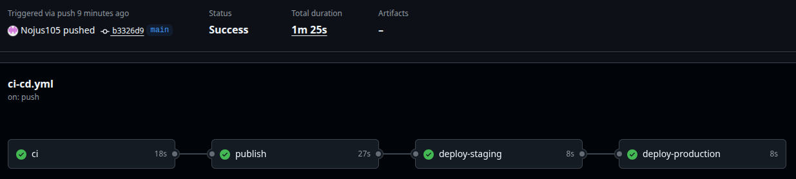

# .NET Docker CI/CD


Minimal .NET 10 Web API packaged into a multi-stage Alpine Docker container with a GitHub Actions CI/CD pipeline, immutable GHCR image publishing, staging-to-production promotion with manual approval gates, and automated rollback on failed readiness checks.

## Pipeline Flow

```text
Push / PR to main
       │
       ▼
  [ 1. ci ]
  Build image locally & run deploy_and_verify.sh (readiness check)
       │
       │  (main branch only)
       ▼
  [ 2. publish ]
  Build & push ghcr.io/nojus105/status-api:<git-sha>
       │
       ▼
  [ 3. deploy-staging ]  (environment: staging)
  Pull exact SHA image & verify /health/ready
       │
       ▼
  Manual Approval Gate   (GitHub Required Reviewers)
       │
       ▼
  [ 4. deploy-production ]  (environment: production)
  Promote same SHA image; auto-rollback to previous image if readiness fails
```



## Key Design Decisions

- **Multi-stage Alpine build:** Compiles in `mcr.microsoft.com/dotnet/sdk:10.0-alpine` and copies only published artifacts into `mcr.microsoft.com/dotnet/aspnet:10.0-alpine`, keeping the final runtime image lean and free of build tools.
- **Non-root container execution:** Runs under the built-in `app` user on unprivileged port `8080`, paired with a container-level `HEALTHCHECK` using BusyBox `wget`.
- **Liveness vs. readiness separation:** Docker monitors process health via `/health/live`, while the deployment script gates traffic readiness via `/health/ready`.
- **Immutable artifact promotion:** Images are tagged with `${{ github.sha }}` instead of mutable `:latest` tags, guaranteeing the exact container tested in staging is the one promoted to production.
- **Automated rollback:** `deploy/deploy_and_verify.sh` records the running container's image via `docker inspect` before replacing it. If the new container fails 10 consecutive readiness checks (`curl -fsS`), it is removed and the previous image is restored automatically.
- **Least-privilege CI permissions:** Workflow jobs explicitly scope `GITHUB_TOKEN` permissions (`packages: write` only during `publish`; read-only for deployments).

## Repository Layout

```text
.
├── .github/
│   └── workflows/
│       └── ci-cd.yml            # 4-stage CI/CD pipeline with environment gates
├── deploy/
│   └── deploy_and_verify.sh     # Zero-dependency deploy & auto-rollback script
├── docs/
│   └── pipeline.png             # Verified GitHub Actions run & approval gate
├── src/
│   └── StatusAPI/
│       ├── Program.cs           # Minimal API with health & version endpoints
│       └── StatusAPI.csproj     # .NET 10 web project definition
├── Dockerfile                   # Multi-stage Alpine build + HEALTHCHECK
├── .dockerignore
├── .gitignore
└── README.md
```

## Endpoints

| Endpoint | Method | Response | Purpose |
| :--- | :--- | :--- | :--- |
| `/health/live` | `GET` | `200 OK` (`Healthy`) | Container liveness probe (polled by Docker `HEALTHCHECK`) |
| `/health/ready` | `GET` | `200 OK` (`Healthy`) | Deployment readiness gate (polled by `deploy_and_verify.sh`) |
| `/version` | `GET` | `{"service":"status-api","version":"<sha>"}` | Reports the `APP_VERSION` build argument baked into the image |

## Local Quickstart

Only Docker is required on the host—the .NET 10 SDK runs inside the build container.

```bash
# Build with a version tag baked into APP_VERSION
docker build --build-arg APP_VERSION=v1-local -t status-api:v1 .

# Run detached on port 8080
docker run -d --name status-api -p 8080:8080 status-api:v1

# Verify endpoints
curl http://localhost:8080/health/live && echo ""
curl http://localhost:8080/version && echo ""

# Confirm container reports (healthy) after ~15s
docker ps --filter name=status-api
```

## Testing Automated Rollback Locally

With `status-api:v1` built locally, deploy it using the script and then simulate a broken release with an image that does not serve port `8080`:

```bash
chmod +x deploy/deploy_and_verify.sh

# 1. Deploy known-good version
./deploy/deploy_and_verify.sh status-api:v1

# 2. Deploy a broken image (exits immediately, fails /health/ready 10x)
./deploy/deploy_and_verify.sh alpine:latest
```

After 10 failed readiness attempts (~20 seconds), the script removes the broken container, restores `status-api:v1`, logs `[ROLLBACK COMPLETE]`, and exits with code `1` so CI pipelines still flag the failed release.

Clean up when finished:

```bash
docker rm -f status-api
```

## GitHub Actions & Environment Setup

To replicate this pipeline in a fork:

1. Ensure the repository is **Public** (required on GitHub Free for environment protection rules).
2. In **Settings → Environments**, create:
   - `staging` (default settings)
   - `production` (enable **Required reviewers** and add your GitHub username)
3. Push to `main`. `ci`, `publish`, and `deploy-staging` run automatically; `deploy-production` pauses until approved under **Actions → Review deployments**.